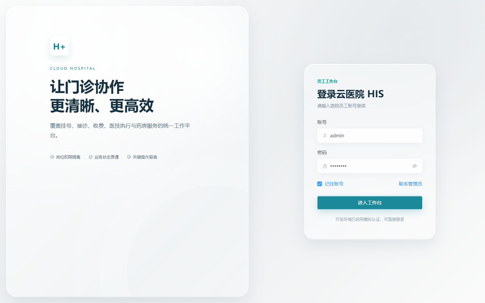
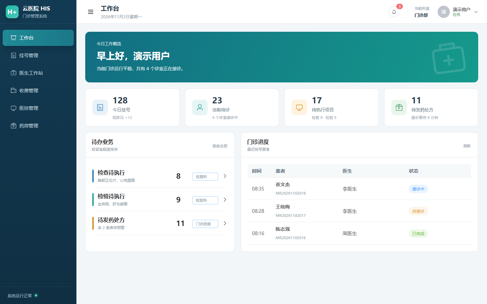
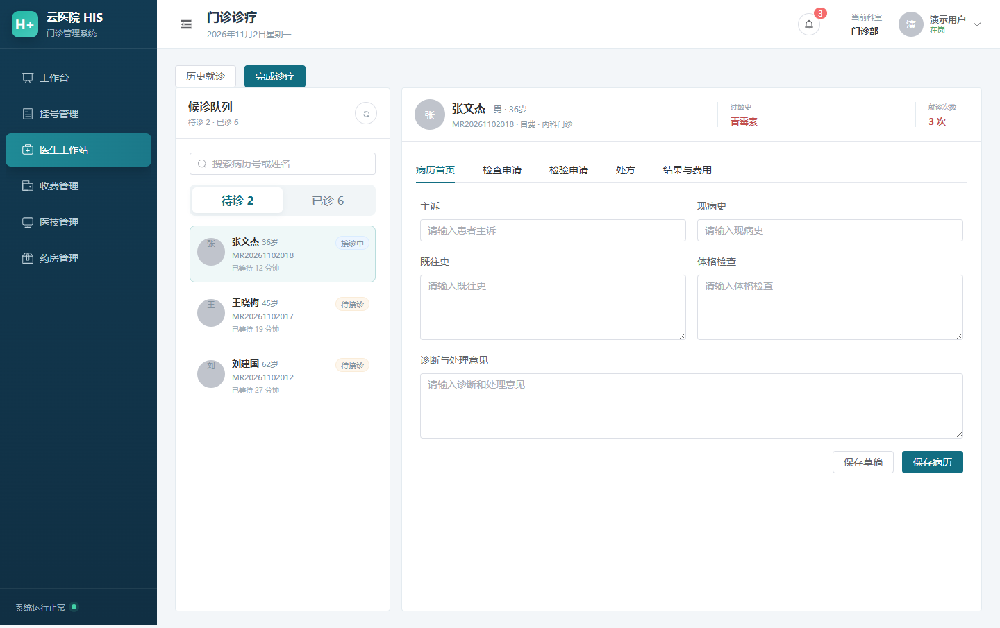

# Cloud Hospital HIS

云医院HIS门诊管理系统，面向挂号收费员、门诊医生、医技人员和药房工作人员，覆盖挂号、接诊、收费、检查检验、处置及发退药流程。

## 本地开发

需要 JDK 17、Maven 3.9、Node.js 20+、MySQL 8 和 Redis。

### 首次初始化

1. 启动 MySQL，在项目根目录打开 CMD 并进入 SQL 目录：

```text
cd sql
mysql -u root -p
```

如果提示 `mysql` 不是命令，请改用 MySQL 安装目录下的程序，例如：

```text
"C:\Program Files\MySQL\MySQL Server 8.0\bin\mysql.exe" -u root -p
```

2. 输入 MySQL 密码，出现 `mysql>` 后逐行执行：

```sql
source his_cloud.sql
USE his_cloud_completed;
source ruoyi_system.sql
source quartz.sql
source his_demo_data.sql
```

`his_cloud.sql` 会创建并切换到 `his_cloud_completed` 数据库，后三个脚本必须继续在该数据库中执行。最后一个脚本提供作业演示账号、基础目录和虚构患者，可重复执行；不需要演示数据时可以跳过。

数据库表关系、状态流转和设计说明见[数据库设计说明](docs/数据库设计说明.md)；三人协作的接口路径、字段、状态值和数据归属见[数据库接口名单](docs/数据库接口名单.md)。

3. 检查导入结果：

```sql
SHOW TABLES;
SELECT user_id, user_name, status FROM sys_user;
exit
```

正常应显示 53 张表，并能查询到 `admin` 用户。执行演示脚本后还提供 `doctor`、`cashier`、`examiner`、`lab`、`treatment`、`pharmacy` 六个岗位账号，演示密码均为 `admin123`。

4. 在 `frontend` 目录将 `.env.example` 复制为 `.env.development`，然后执行 `npm install`。
5. 启动 Redis。数据库账号不是默认的 `root/password` 时，在 IDEA 的 `RuoYiApplication` 运行配置中设置 `HIS_DB_USERNAME`、`HIS_DB_PASSWORD` 环境变量。

### 日常启动

- 后端：在 IDEA 中运行 `backend/ruoyi-admin` 下的 `RuoYiApplication`。
- 前端：在 `frontend` 目录执行：

```text
npm run dev
```

后端地址为 `http://localhost:8080`，默认账号为 `admin/admin123`。环境字段的用途已写在 `.env.example` 注释中：默认 `VITE_USE_MOCK_AUTH=true`，前端可以独立运行；与真实后端联调时只需改为 `false`。只有后端端口或地址发生变化时，才需要修改 `VITE_APP_PROXY_TARGET`。

### 命令行启动后端（可选）

不使用 IDEA 时，首次在 `backend` 目录执行一次 `mvn install -DskipTests`，此后进入 `backend/ruoyi-admin` 执行 `mvn spring-boot:run` 即可。

## 前端效果图

### 登录页



### 工作台



### 医生工作站



