# 云医院HIS门诊管理系统开发需求

## 1 开发目标

开发一套面向医院工作人员的门诊后台管理系统，实现患者从挂号、医生接诊、缴费到检查检验、处置和取药的基本流程。

患者不登录系统。系统使用者包括挂号收费员、门诊医生、检查医生、检验医生、处置医生、药房工作人员和系统管理员。

## 2 技术方案

| 部分 | 技术 |
|---|---|
| 前端 | Vue 3、Element Plus、Axios、Pinia |
| 后端 | RuoYi、Spring Boot、MyBatis |
| 数据库 | MySQL 8 |
| 权限 | RuoYi用户、角色、菜单和按钮权限 |

采用前后端分离架构。后端按 `Controller → Service → Mapper` 分层，登录、权限、菜单、字典和日志直接使用RuoYi现有能力。

## 3 功能模块

### 3.1 基础数据

- 科室、员工和医生。
- 挂号级别和医生排班。
- 结算类别和疾病目录。
- 检查、检验、处置项目。
- 药品信息。

### 3.2 挂号收费

- 录入患者信息，选择科室、挂号级别和出诊医生，完成挂号。
- 根据排班显示可选医生；医生号额已满时禁止挂号。
- 查询未看诊记录并办理退号。
- 查询医生开立的项目并收费。
- 查询费用记录，对未消费项目办理退费。

### 3.3 门诊医生

- 查看当前医生的待诊和已诊患者。
- 接诊患者并填写病历。
- 开立检查、检验和处置申请。
- 开立药品处方。
- 查看检查和检验结果。
- 填写诊断和处理意见。
- 查看项目费用及缴费、执行状态。

### 3.4 检查 检验和处置

三个模块分别由对应岗位使用，处理方式一致：

- 查看已缴费的待执行患者和项目。
- 登记执行科室和执行人员。
- 开始执行并录入结果。
- 查询历史项目及结果。

### 3.5 药房

- 查询已缴费的待发药处方并发药。
- 查询已发药记录并办理退药。
- 按编码、名称或拼音助记码查询药品。
- 查询患者的药品交易记录。

### 3.6 系统管理

- 用户、角色、菜单和权限管理。
- 关键操作日志查询。

## 4 核心流程

```text
挂号
  → 医生接诊并填写病历
  → 开立检查 检验 处置或处方
  → 收费
  → 医技科室执行或药房发药
  → 医生查看结果并完成诊断
```

## 5 关键规则

1. 挂号成功后，患者才进入对应医生的待诊列表。
2. 只有未看诊的挂号记录可以退号。
3. 医生号额已满时不得继续挂号。
4. 项目缴费后，医技科室才能执行，药房才能发药。
5. 已执行的检查、检验和处置项目不能直接退费。
6. 已发药的药品必须先退药，再办理退费。
7. 金额由后端根据单价和数量计算并校验。
8. 关键接口必须校验用户权限和当前业务状态。
9. 诊疗、收费和发退药记录不得通过物理删除撤销。

## 6 开发顺序

1. **项目基础：**搭建RuoYi前后端项目，完成数据库、登录、角色和菜单配置。
2. **基础数据：**完成科室、员工、排班、项目和药品管理。
3. **门诊主流程：**完成挂号、接诊、病历、申请、处方和收费。
4. **执行流程：**完成检查、检验、处置、发药和结果查看。
5. **收尾功能：**完成退号、退费、退药、日志和核心流程测试。

## 7 接口清单

接口统一使用 `/his` 前缀，沿用RuoYi的登录认证、分页参数和响应结构。

### 7.1 基础数据接口

基础数据统一提供列表、详情、新增、修改和删除接口：

- `GET {资源路径}/list`
- `GET {资源路径}/{id}`
- `POST {资源路径}`
- `PUT {资源路径}`
- `DELETE {资源路径}/{ids}`

| 资源 | 资源路径 |
|---|---|
| 科室 | `/his/department` |
| 员工与医生 | `/his/employee` |
| 挂号级别 | `/his/registrationLevel` |
| 医生排班 | `/his/schedule` |
| 结算类别 | `/his/settlementCategory` |
| 疾病目录 | `/his/disease` |
| 医技项目 | `/his/medicalTechnology` |
| 药品信息 | `/his/drug` |

### 7.2 挂号收费接口

| 方法 | 路径 | 用途 |
|---|---|---|
| GET | `/his/registration/availableDoctors` | 查询可挂号医生 |
| GET | `/his/registration/list` | 查询挂号记录 |
| GET | `/his/registration/{id}` | 查询挂号详情 |
| POST | `/his/registration` | 窗口挂号 |
| POST | `/his/registration/{id}/cancel` | 窗口退号 |
| GET | `/his/charge/pending/{registrationId}` | 查询待收费项目 |
| POST | `/his/charge` | 完成门诊收费 |
| GET | `/his/charge/list` | 查询费用记录 |
| GET | `/his/refund/available/{registrationId}` | 查询可退费项目 |
| POST | `/his/refund` | 办理退费 |

### 7.3 门诊医生接口

| 方法 | 路径 | 用途 |
|---|---|---|
| GET | `/his/doctor/visits` | 查询当前医生的待诊和已诊患者 |
| POST | `/his/visit/{registrationId}/accept` | 接诊患者 |
| GET | `/his/medicalRecord/{registrationId}` | 查询本次病历 |
| PUT | `/his/medicalRecord` | 保存病历 |
| POST | `/his/medicalOrder` | 开立检查 检验或处置申请 |
| POST | `/his/prescription` | 开立药品处方 |
| POST | `/his/medicalOrder/{type}/{id}/cancel` | 作废未缴费申请或处方 |
| GET | `/his/visit/{registrationId}/results` | 查询医技结果 |
| PUT | `/his/visit/{registrationId}/diagnosis` | 保存诊断和处理意见 |
| POST | `/his/visit/{registrationId}/complete` | 完成本次诊疗 |
| GET | `/his/visit/{registrationId}/costs` | 查询本次就诊费用 |

### 7.4 检查 检验和处置接口

`{type}` 取值为 `check`、`inspection` 或 `disposal`。

| 方法 | 路径 | 用途 |
|---|---|---|
| GET | `/his/execution/{type}/pending` | 查询待执行项目 |
| POST | `/his/execution/{type}/{id}/start` | 登记并开始执行 |
| POST | `/his/execution/{type}/{id}/complete` | 录入结果并完成执行 |
| GET | `/his/execution/{type}/list` | 查询历史项目及结果 |
| GET | `/his/execution/{type}/{id}` | 查询项目详情 |

### 7.5 药房接口

| 方法 | 路径 | 用途 |
|---|---|---|
| GET | `/his/pharmacy/dispensing/pending` | 查询待发药处方 |
| POST | `/his/pharmacy/dispensing/{prescriptionId}` | 确认发药 |
| GET | `/his/pharmacy/return/available` | 查询可退药记录 |
| POST | `/his/pharmacy/return/{prescriptionId}` | 确认退药 |
| GET | `/his/pharmacy/transactions` | 查询药品交易记录 |

具体请求字段、响应字段和权限标识在编码对应模块时补充。

## 8 页面原型

以下原型图直接取自参考需求规格，开发时使用Vue 3和Element Plus按RuoYi布局实现。

### 8.1 挂号收费

#### 窗口挂号

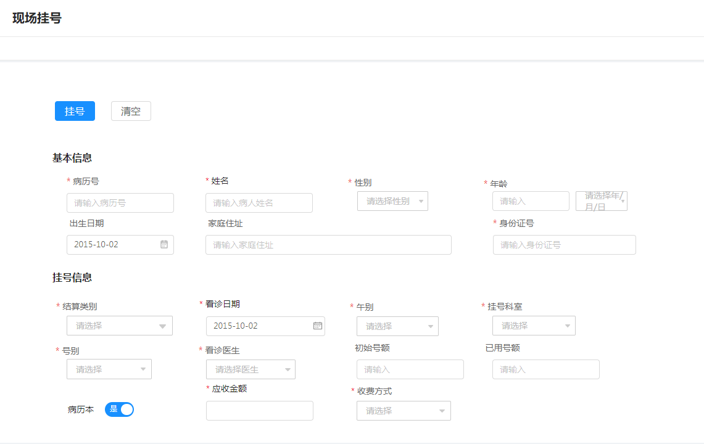

#### 窗口退号

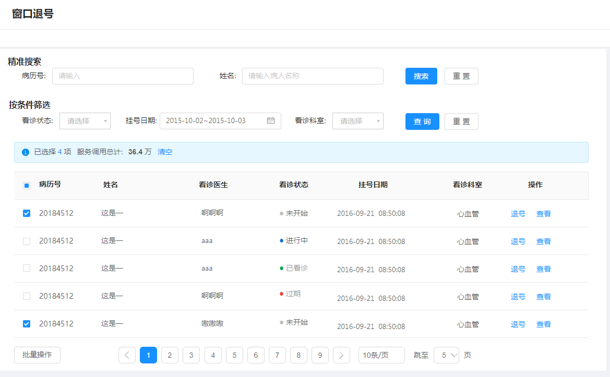

#### 门诊收费

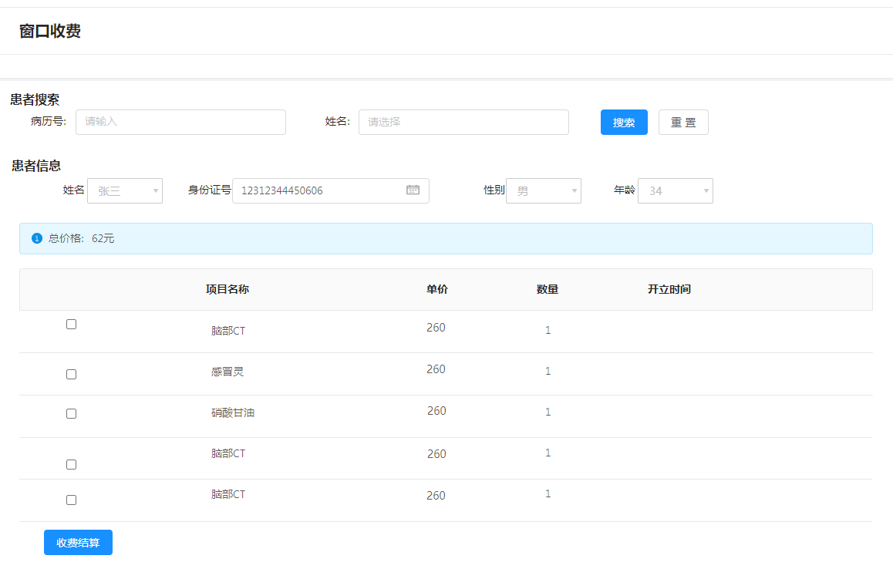

#### 窗口退费

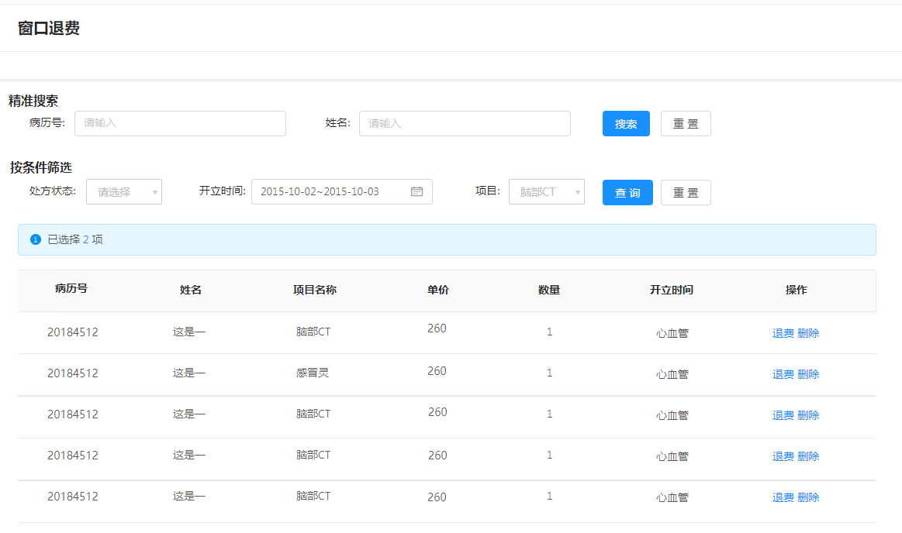

#### 费用记录查询

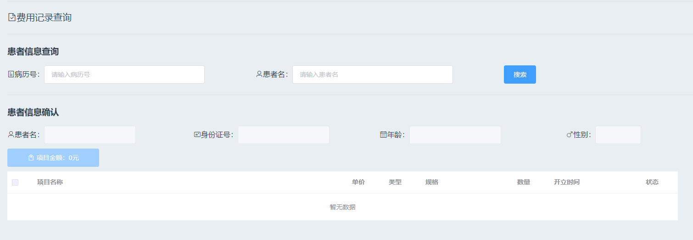

### 8.2 门诊医生

#### 患者查看

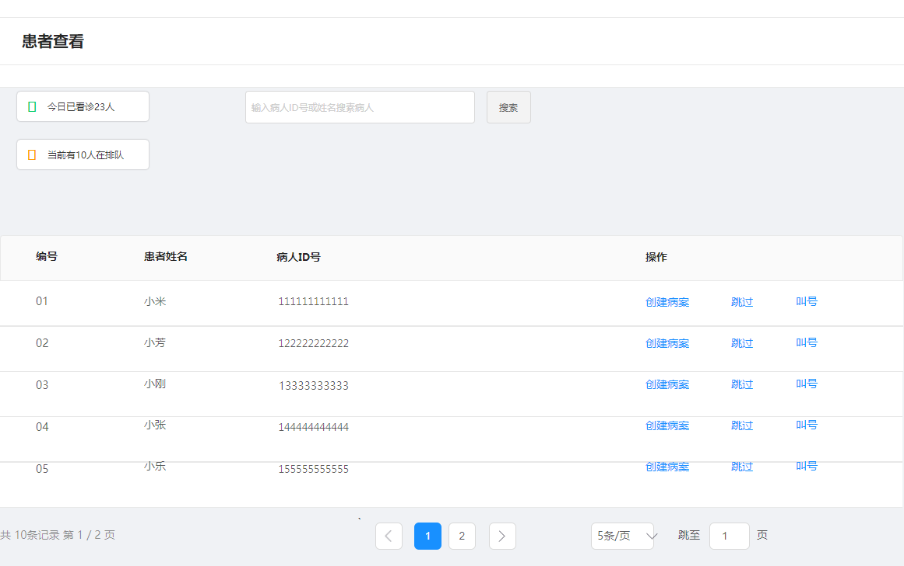

#### 病历首页

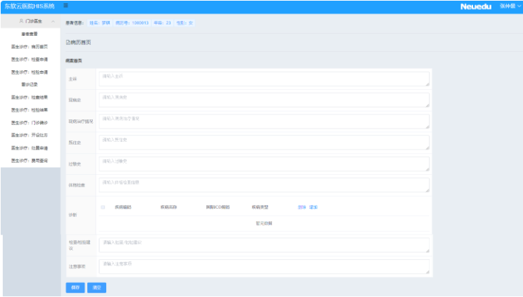

#### 检查申请

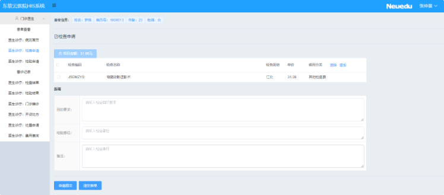

#### 检验申请

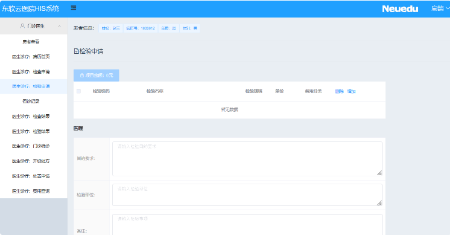

#### 检查结果

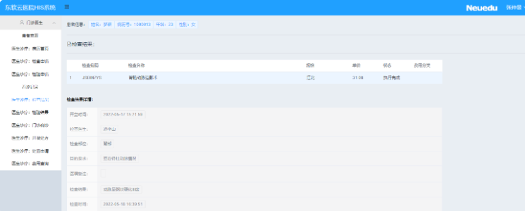

#### 检验结果

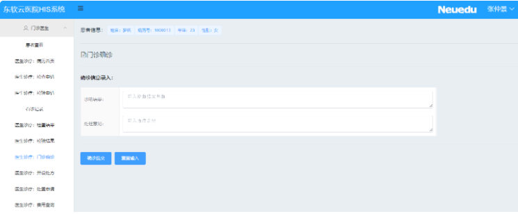

#### 门诊确诊

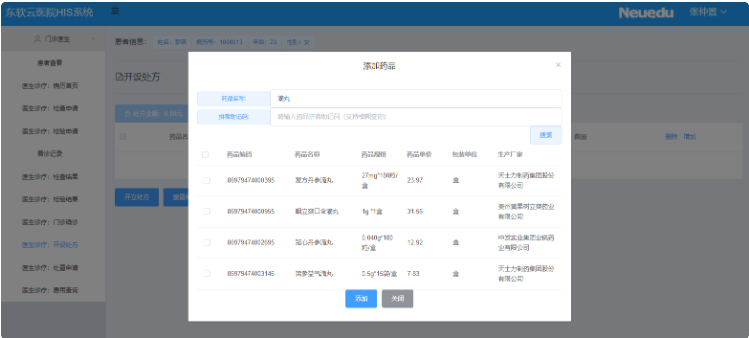

#### 开设处方

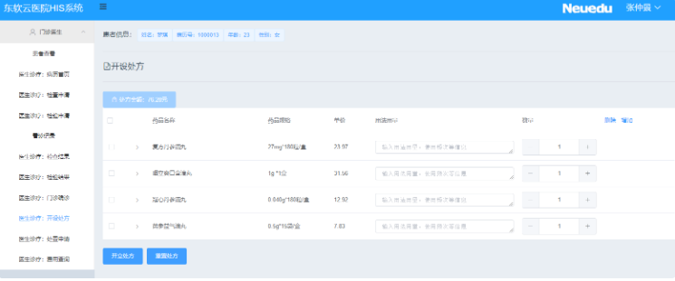

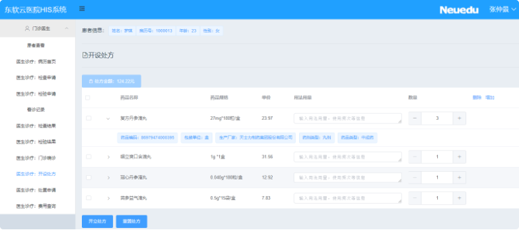

#### 处置申请

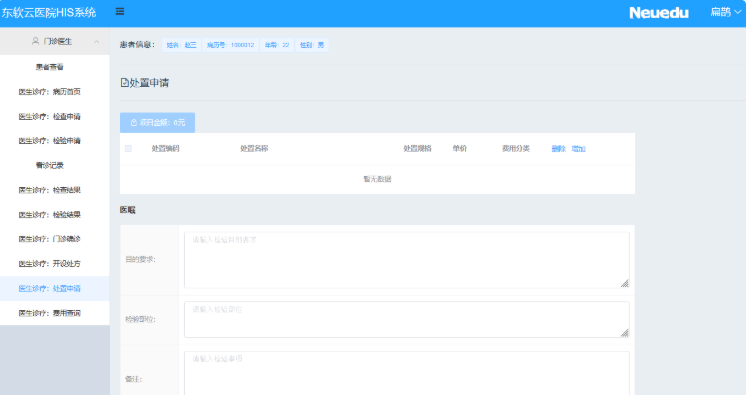

#### 费用查询

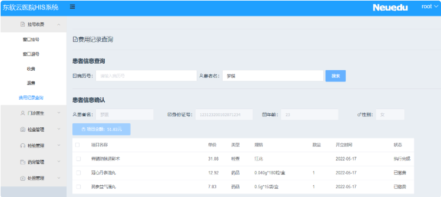

### 8.3 检查管理

#### 待执行患者

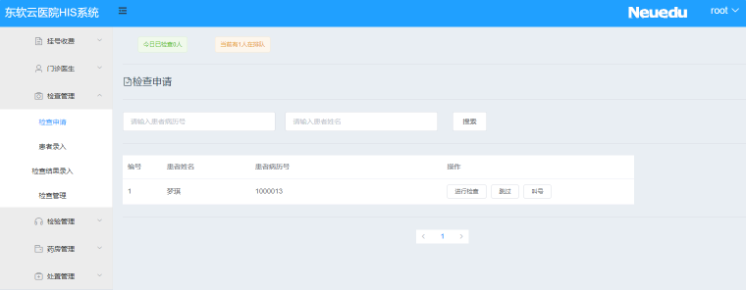

#### 患者录入

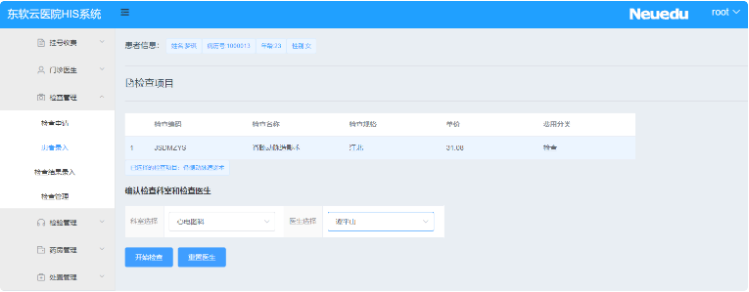

#### 结果录入

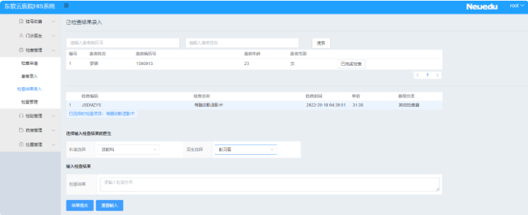

#### 检查查询

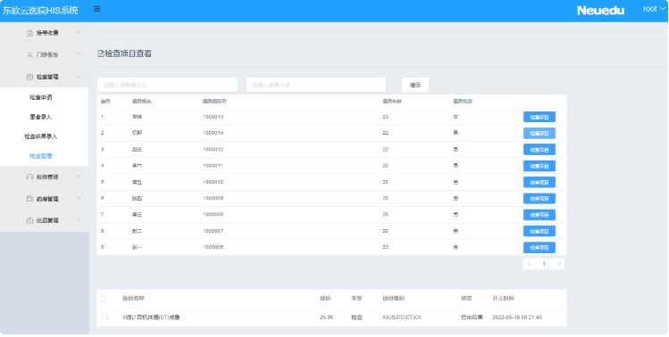

### 8.4 检验管理

#### 待执行患者

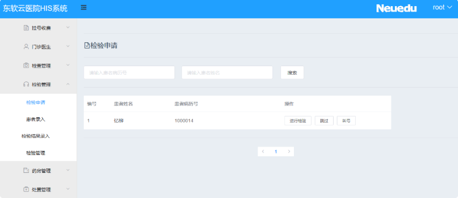

#### 患者录入

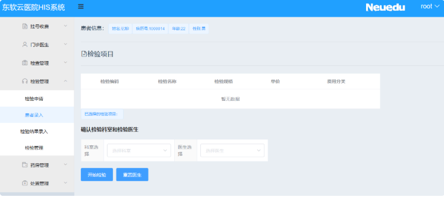

#### 结果录入

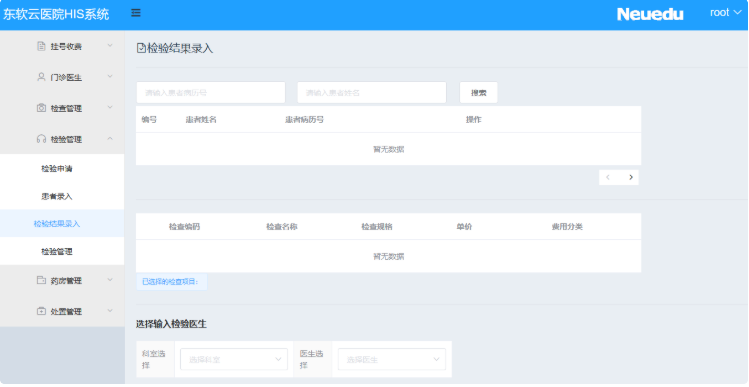

#### 检验查询

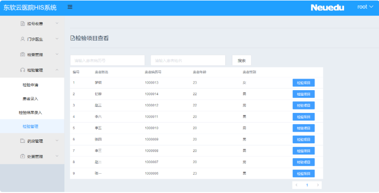

### 8.5 药房管理

#### 药房发药

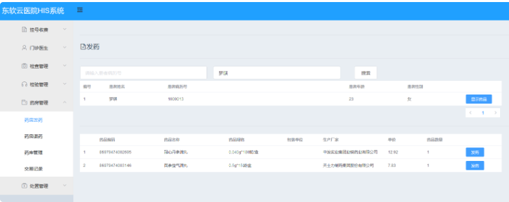

#### 药房退药

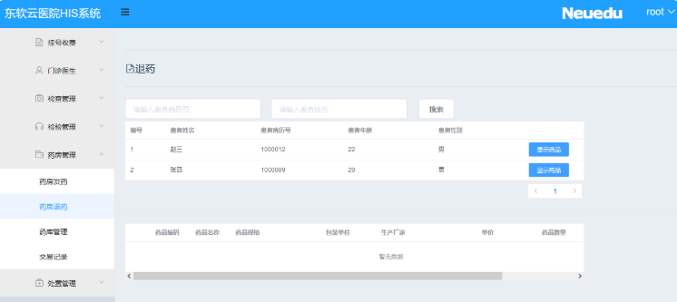

#### 药品查询

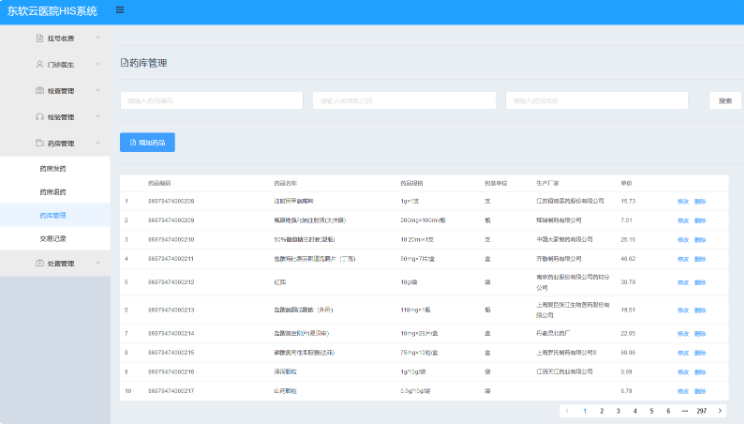

#### 药品交易记录

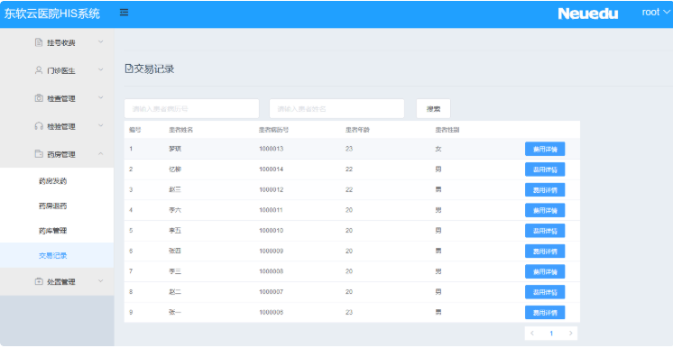

### 8.6 处置管理

#### 待执行患者

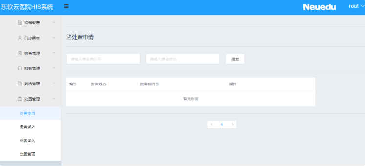

#### 患者录入

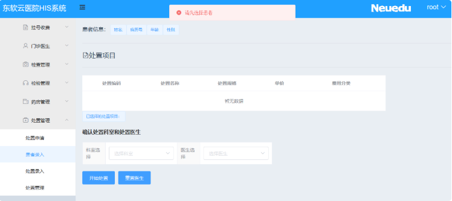

#### 结果录入

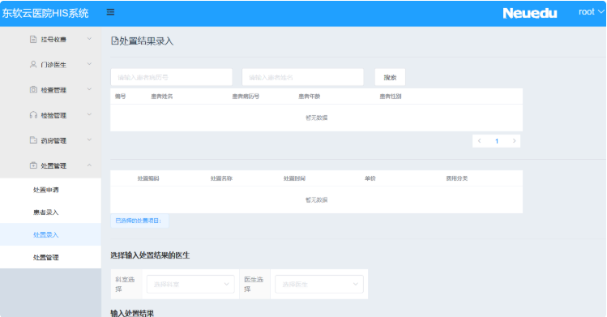

#### 处置查询

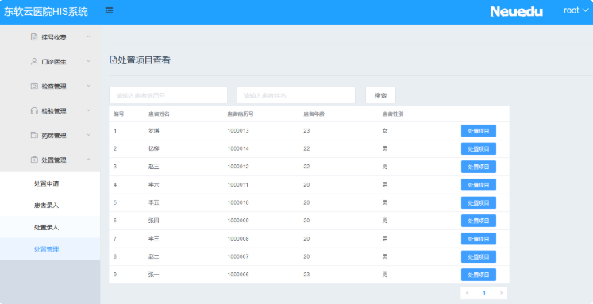

## 9 后续补充

开发时按需要补充接口字段、权限标识、状态流转和测试用例，不在本文预先展开。

